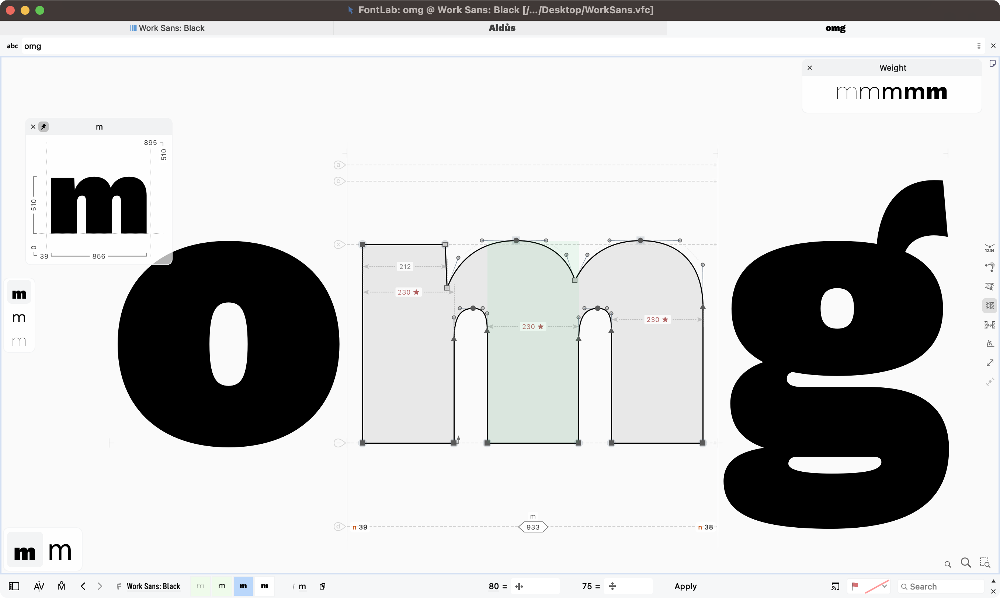
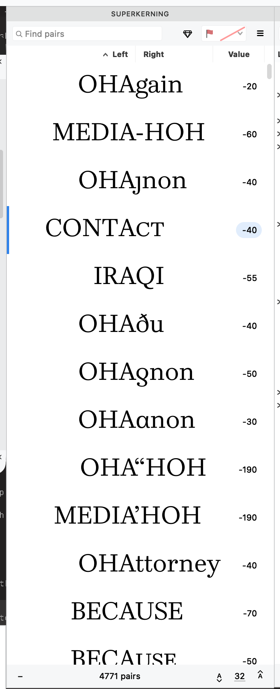
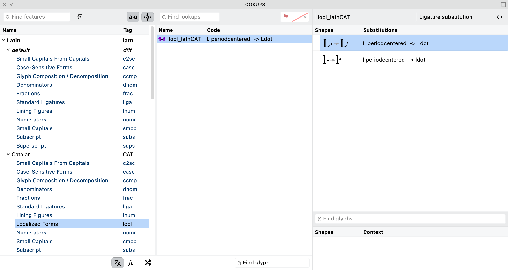
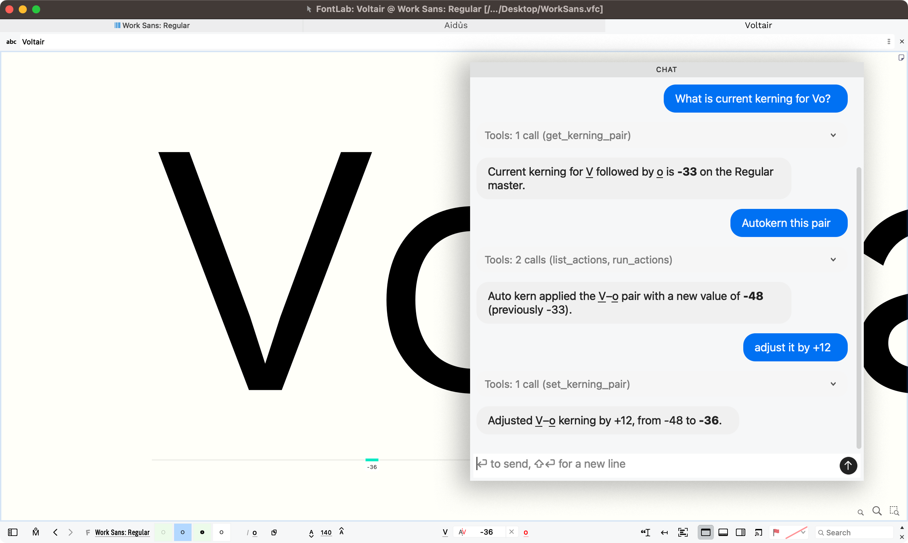
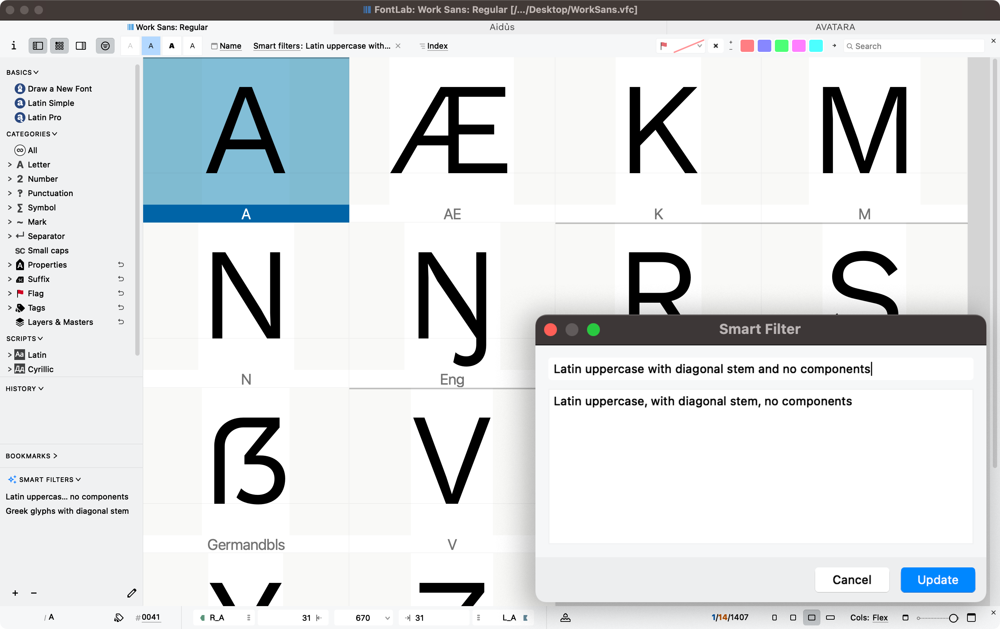

**[FontLab 9](https://www.fontlab.com/font-editor/fontlab/whats-new/)** for Mac and Windows is now available. Revolutionary stem editing. Ultrasmooth tangents. Curved interpolation. Bracket layers. Optical oblique. Neural spacing & kerning. Visual features. AI, MCP & UI in 19 languages. [Buy lifetime:](https://fontlab.onfastspring.com/fontlab9) $499. [Upgrade from FontLab:](https://pass.fontlab.com/upgrade/fl9) $149, $49 or free!.

Ask **Aidus**, FontLab’s built-in assistant powered by a large language model of your choice, anything: ask it about the app, about the current font. Ask it to build Font window filters, to write simple Python scripts, to write proof texts. Create a new glyph with Aidus using context-aware image generation.

Adjust the weight, width and slope of stems across one or several glyphs with the new **Stem tool**: visually, by units or by percentage. View Thickness consistency along curved and diagonal stems with **Quick measurement** rainbow.

Draw more confidently with the improved **Pen tool**: preview the next segment, draw corners, curves and tangents, or refine existing handles. Draw live calligraphic strokes with new **Power Brush**: use the **Thickness** tool to change the brush thickness, angle and roundness for every node. Add variation-compatible ink traps.

Ensure perfect G2-smoothness with **Genius** Tangent nodes when a line segment transitions to curve, and on rounded **Smart Corners**. Simplify part of a contour with the new **Trowel** tool, or clear an area with the **Cleaner** tool. Turn bitmap images into contours more accurately with improved **Autotrace**.

Turn on **Quick Preview on drag** and focus on the shape whenenver you drag: all the distractions disappear. Turn all snapping on and off at once with **Enable Snapping**. Repeat the last command on a different glyph or layer with **Repeat**.

Interpolate along curves with the **Sigma tool**. Switch construction partway along the axis with **bracket layers**. Slant glyphs with **Make oblique** action that performs automatic optical adjustment.

Kern existing and planned pairs in the new **Superkerning** panel. Use one set of kerning classes in all masters. **Auto Space** and **Auto Kern** with new neural algorithms. Preview multiple font sizes, masters, instances in the new **Notepad** panel; build and edit specimens, and export then to PDF.

Selectively copy-paste contours, appearance, metrics, anchors, guides, hints or masks across masters with **Paste Special**. Reuse **Skin** elements. Reshape elements with the **Mesh** filter. See which glyphs have contours, components or advanced elements with **Color-code element type**.

Visually edit and test features for all writing systems in the **Lookups** editor, test with the step-by-step lookup debugger. Control ligature **caret** positioning with anchors. Export visual TrueType hints into static and variable fonts with the genuine **VTT** engine.

Open and export Glyphs 4 files. Import Open Font Format 2026 fonts with cubic TrueType outlines, variable components and `avar` version 2 mappings. Automate your work with improved Python scripting. Automate FontLab from external scripts and agents with the built-in **MCP server**.

Use the interface and built-in help in **19 languages**: English, Deutsch, Français, Español, Polski, Čeština, हिन्दी, Bahasa Indonesia, Italiano, 日本語, 한국어, Português, Русский, ไทย, Türkçe, Українська, Tiếng Việt, 简体中文, 繁體中文. Learn FontLab 9 from the all-new **user manual**. Simplify the user interface with **Focused Menu**.

<!-- more -->

## Edit a stem as a stem

A stem is two sides of a contour, but you think of it as one shape: the upright of an l, the crossbar of an H, the diagonal of a V, the pair of opposing curves at the top and bottom of an o. With the new **Stem tool**, you can work with it as one. Hover over a stem in the Glyph window and FontLab highlights it in light green, together with its connected nodes, attached serifs and corners. Click to select it. Move it, rotate it, or change its thickness. Shift-click more stems in the same glyph or across multiple glyphs. FontLab changes the contours so that some parts change fully and some change partially, to retain the logical structure of the glyph, including the joins between strokes. The result remains an ordinary outline that you can refine with the Contour tool.

Compared to old curve-editing techniques, the Stem tool is much faster, but it’s not an artificial one-click filter. You can quickly create bold or condensed variations, or experiment with scaling the counters or with the placement of a horizontal bar, but you’re always in control of the changes.

Click the Stem tool icon on the toolbar or tap ++6++ to activate it. Repeat to cycle through its three subtools, ==Move==, ==Thickness== and ==Rotate==, or pick one in the Toolbox or the Stem widget.

- ==Move== shifts a stem without changing its width. Raise the crossbar of an H to balance its counters, or shift the middle stem of an m.
- ==Thickness== changes the width. Enter `90` to make every selected stem 90 font units wide, or `+5` to add five units to each. Enter `112%` to scale each selected stem to 112% of its own width, or `+12%` and `-12%` for relative changes. A unit value makes every selected stem the same; a percentage keeps their proportions, so a heavier stem stays heavier than a lighter one.
- ==Rotate== changes the angle. Double-click a vertical stem to lean it to the master’s italic angle.

Arrow keys move the selected stems by one unit, or resize them in Thickness mode. With ++shift++, the step is 10 units, or the next larger or smaller **standard stem** declared for the current master and orientation in ==Font Info > Stems==. Numeric controls show *Mixed* when the selected stems have different values.

Stem edits respect your spacing. If your sidebearings are plain numbers, the advance width stays fixed. If you turn on ==Keep sidebearings== in the Stem toolbox, or if your sidebearings are bound or use an expression, the sidebearing distances stay fixed and the advance width adapts to the new outline.

The tool also works across a word. Type a string of visually related glyphs such as *hamburgefontsiv* into the Glyph window, turn on ==Edit > Edit Across > Glyphs== with the inactive glyphs unlocked, and Shift-click, frame or lasso stems in several letters. Enter `104%`: each stem grows by 4% of its own width, and the relation between thick and thin stems is retained. FontLab records the edit as one undo step and reports how many glyphs were edited or rejected. If one glyph cannot accept a change, it keeps its last valid outline while the other selected glyphs still update.

The Stem tool changes outlines only; Font Info stem definitions and hints stay unchanged. FontLab skips diagonal detection on layers with more than 1,000 nodes or 100 contours. With ==Match Edits== on, diagonal stem edits apply across masters, while horizontal and vertical stem edits affect the active layer only.

## Measure along the stroke

Measurement follows more of the drawing. **Quick Measurement** measures the stem width under the pointer, and the thickness **Rainbow** shows thickness along straight and curved stems as a colored band, with their edges and centerline. You can check the weight where the shoulder of n meets its upright, around the bowl of an o or through the slanted stroke of a V. Rainbow avoids ambiguous sharp corners and stops at intervening closed contours; in FontLab 8, it could continue across them. The display helps you locate a change in weight. It does not change the outline.

The new **Measurements widget** brings the measuring controls together in the Glyph window: quick thickness measurement, automatic stem and counter measurements, segment lengths and angles, tension, node coordinates and curvature. Turn on the measurements you need for the current correction.

Tension expresses a curve handle’s length as a proportion of its full extension toward the intersection of the handle directions, so you can compare curves of different sizes without relying only on handle lengths in font units. The **Nodes** panel now has a tension strip with a mark for each selected curve. Click to set a common value, or drag to change all selected tensions by the same amount while keeping their differences. When the bowls of o, c and e don’t quite agree, the strip helps you find the unusually tight or loose segment. Font-wide default Curve and Corner tension remain in ==Font Info > Font Dimensions==.

## Shape the transition between masters with Sigma

A pair of good masters doesn’t always produce the shapes you want in between. A counter can close too quickly on its way to a heavier weight, or a join can gain more weight than the surrounding strokes.

The new **Sigma tool** lets you adjust how corresponding points move between compatible masters. Instead of following straight paths, selected points can follow quadratic or cubic trajectories that you shape yourself. The positions in the source masters stay unchanged, so you work on the transition without redrawing its endpoints. Variable fonts exported with Sigma use non-linear interpolation. Sigma variable export is experimental, with restrictions on combining Sigma and bracket switching in affected glyphs.

## Switch construction with bracket layers

Some glyphs need a different construction at different points in a family. A dollar sign can use two strokes in lighter weights and switch to one in heavier weights. **Bracket layers** let a glyph change construction at a chosen location in the design space. Both designs stay in the same glyph. Masters within each range remain compatible, while the drawings on opposite sides of the switch can have different contour structures.

Bracket conditions can involve more than one axis. Supported switches export to variable TrueType and CFF2 fonts.

## Keep fonts, masters and variations beside the outline

New Glyph window widgets put useful information beside the drawing. The **Info** widget shows the current glyph’s name, preview, metrics and bounds; you can move and pin it beside the drawing. The **Fonts** widget shows the same glyph in other open fonts, or a placeholder if the glyph is missing, and a click on a thumbnail switches fonts. Compare the g in a roman and an italic, or a drawing in two related families, without leaving the Glyph window.

The reworked **Variations** widget lets you choose an axis and click or drag on the glyph preview itself to change the design location. Scrub between weights while watching a counter or a join. Resize the widget to see more previews along an axis: it marks master locations and fits intermediate samples between them, and clicking a master sample activates that layer. ==Link matching axes== links axes with the same OpenType tag. The **Masters** widget activates a master from its thumbnail. ==Match Moves== and ==Match Edits== are now also in the Toolbox, as well as in the Variations panel.

## Kern many pairs at once in Superkerning

**Superkerning** is a fully new panel, available from ==Window > Panels > Superkerning==. It adds a workspace beside the existing Kerning and Pairs & Phrases panels; it does not replace them. Pairs that already have kerning and pairs planned from a text list appear together, so you can review the work you’ve done and find relationships you haven’t kerned yet, without first creating values for every pair.

Choose one of three views from the panel menu:

- **Table view** shows compact rows with Left, Value and Right columns. Pair names and class-member shapes appear beside the value. Compare many pairs at once, sort the rows, or search for a glyph that belongs to a class.
- **Simple preview** shows each pair in text, with its kerning value beside it. The preview uses a word from the pair list when one is available, or neutral surrounding letters. It hides class overlays and the center guide, so you can judge the spacing as text.
- **Detailed preview** keeps that text context but emphasizes the active pair. Surrounding letters are muted; class-member outlines appear in blue around the pair, with a center guide. That makes it easier to catch a value that suits the representative pair but causes trouble for an accent or a different terminal elsewhere in the class.

{ align=right loading=lazy width="50%" }

Work directly in the panel. Filter by glyph names and class members, type a value, adjust it with the arrow keys, or drag in a preview. Press ++semicolon++ to autokern the selected rows, or the current row when none is selected. In a focused preview, tap ++space++ to switch between Simple and Detailed preview, or hold it to see the other preview temporarily. Previews, widths, class membership and pair values follow the selected font master, so the shapes you judge belong to the values you edit, and editing stored pairs keeps the table’s selection and scroll position, so you don’t lose your place in a long review.

Select several rows and change their kerning together with the arrow keys or a horizontal drag. Every selected pair moves by the same amount from its own starting value: a pair at −100 and a planned pair with no value both move by +25, to −75 and +25. If To, Tr, Tu and Ty all look a little too tight after autokerning, search for T, select those four rows and drag to loosen them. Their relative order stays as it was, and one Undo reverses the whole adjustment.

Superkerning keeps its own suggested-pair list, separate from Pairs & Phrases. By default, suggestions use the combined Latin, Cyrillic and Greek lists; ==Suggested pairs…== chooses another list. Editing a planned pair gives it a saved value, and autokerning stores successfully calculated results. An explicit zero remains different from a pair with no stored value. General operations such as kerning audit, adjustment and removal act on the whole font, so check their scope before using them.

## Start spacing and kerning with local neural predictions

**Autokerning** gains a neural method, and **Auto Space** can use neural spacing. Both run locally: with the **neural** methods selected in ==Preferences > Spacing==, FontLab calculates sidebearings and pair adjustments for review without an Aidus provider, an API key or data sent to a provider. Review the proposed spacing and kerning in text and change the numbers as usual. The local calculation gives you values to review; it does not decide that the alphabet is finished.

Neural autospacing is primarily intended for basic Latin A–Z and a–z, and predicts spacing for other glyphs in that alphabet’s context. ==Link to key glyphs== can link uppercase sidebearings to H, A or O when the predictions are close. Neural kerning has a pair model and a model that uses font-wide context: in the Glyph window’s Kerning mode, ++semicolon++ uses the pair model and ++colon++ the alternate model. If a neural kerning model is missing, FontLab falls back to the optical method.

The separately selected **optical** kerning method uses a new scanline engine, so recalculated values can differ from FontLab 8. FontLab does not automatically replace saved values.

For families with several masters, a Font Info option keeps **kerning classes synchronized** from the main master. Add Ŧ to the T class once, and every master receives the same class membership, while each master keeps its own pair values. Renaming, deleting or replacing a class updates its pair references in every master, and one Undo restores the affected kerning together. When you match kerning, FontLab can also copy the resulting pair values to all masters. You can also sort class contents by glyph name, Unicode or Font window order, and ==Remove All Pairs…== now asks first and lets you choose whether to remove classes too, and whether to act on all masters.

## Corners, ink traps, obliques and strokes

**Smart Corners** can now be smooth. Toggle smoothing from a corner handle’s context menu or by double-clicking the handle. On curved outlines, the generated corner can preserve curvature continuity with the adjoining segments. While the Node tool is active, Frame and Lasso selection now include Smart Corner handles, anchors and pins, and with several corner handles selected, ++enter++ balances their radii: each corner receives the average of the selected radii.

**Genius nodes** now keep a join between a straight line and a curve curvature-smooth, where a straight stem flows into the shoulder of n, the bowl of b or the arch of h, without FontLab rewriting the source outline. In FontLab 8, this worked at curve-to-curve joins only. The new **Convert Nodes** action removes Genius or Servant status when you want an ordinary node again.

The new **Ink Trap** action cuts traps into matching corner nodes, with depth, width, angle range and smoothing in its dialog and a live preview in the Glyph window. For a text face meant for small sizes, try it on the junctions of v and w, and narrow the angle range if it catches corners you want to keep. A trap with zero width or zero depth still keeps matching nodes across masters, so you can open traps in a heavy master and set them to zero in a light one without breaking interpolation.

**Make oblique**, in ==Tools > Actions > Adjust==, slants and horizontally scales outlines with the curve fitting from Italicize: FontLab corrects the outline through a mesh, beyond the shear that Slant applies, preserves short ink traps and refits the curves. Compare the bowls, counters and joins of an upright o and n with a plain Slant result. The action gives you a starting outline for a sloped design; an italic still needs design work. Refitting can change node structure, so check compatibility across masters before export.

The new **Mesh filter** lets you reshape an element by moving points on an editable mesh, keeping the deformation available for further adjustment.

For strokes, ==Element > Brush & Stroke > Add Stroke== turns a Pen- or Pencil-drawn centerline into an editable stroke with horizontal and vertical thickness, cap and join settings, or into an editable Power Stroke. ==Link== keeps the two thicknesses equal; ==Auto== derives horizontal thickness from vertical. The command moves whole selected contours into a new stroked element, even if you selected only part of a contour.

**Power Brush** has a new engine and an improved **PowerStroke editor**. Vary an elliptical nib’s size, angle and roundness from node to node, with on-canvas handles and numeric feedback; nodes without a local setting inherit the element-wide nib, and FontLab interpolates the settings along the path. Changing the nib at two points of a broad-nib swash alters weight and contrast along its length. The **Thickness tool** adjusts the width and the nib at individual nodes; local thickness is also available in the Node widget and Nodes panel. FontLab regenerates a FontLab 8 live brush with the new engine, so compare the result before expanding a family’s brush elements: expanded outlines no longer have editable nib settings.

## Draw with fewer interruptions

- **See the filled shape while dragging.** Turn on ==Quick Preview on drag== in Editor preferences, and FontLab shows the filled glyph from mouse-down until release when you drag nodes, contours, elements or a Variations control. Judge the letterforms as they change, without holding ++space++.
- **Preview the next segment.** The **Pen tool** previews the segment you are about to draw and lets you draw corners, curves and tangents, or refine existing handles.
- **Simplify part of a contour, or clear an area.** The former Simplify Path mode is now **Trowel**: use it on a chosen section of a contour, such as a traced stroke ending with too many nodes. The new **Cleaner** removes the area under a dragged rectangle in one operation; hold ++shift++ for a square or Alt/Option to draw from the center.
- **Switch all snapping together.** ==View > Enable Snapping== turns all snapping and suggestions off for free placement, then restores them together without changing your individual snapping settings. While it is off, the ==View > Snap== and ==View > Suggest== submenus are hidden, so check this switch first if expected snaps disappear.
- **Repeat a command on the next glyph.** ==Edit > Repeat== (++cmd+r++ on macOS, ++ctrl+r++ on Windows) reruns the last repeatable command on the glyph or selection you choose. The menu names the command and becomes unavailable when the current selection cannot accept it. Repeat does not record a macro, and it does not choose the next glyph for you. Rulers moved to ++cmd+shift+r++ / ++ctrl+shift+r++.
- **Updated Autotrace.** ==Element > Image > Autotrace…== and optical separation use a new tracing algorithm, based on Simon Cozens’ Glyphtracy, that follows the source image more precisely. Because the engine changed, the same saved slider settings can produce different contours from FontLab 8, so compare a re-trace with existing work before replacing it.
- **Zoom to what you are editing.** ==Fit Selection== frames the selected artwork in the Glyph window.
- **Create guides without rulers.** Drag from the top or left edge of the Glyph window to add a glyph guide; hold ++shift++ for a font guide. The **Remove Guides** action can target horizontal, vertical or diagonal guides and filter by tag.
- **Recognize how a glyph is built.** Optional element-type colors distinguish outlines, references, components, strokes and live filters in Font and Glyph window previews, without changing their actual fills. Enable ==Color-code element type== in the Glyph Window or Font Window preferences. Use it before a correction pass to tell a directly drawn glyph from one built from components.
- **Reuse Skin elements.** Copy an active Skin element and paste it onto selected nodes or the active node; FontLab adapts its layer and orientation.
- **Magnet is now Attach.** The tool previously called Magnet is named Attach, leaving the magnet icon associated with snapping.

## A reworked workspace

Document tabs now sit in the title bar on both macOS and Windows. Hold a tab briefly, or start dragging with Alt/Option, to reorder it, and drag an eligible document outside the tab bar to detach it into a separate window for side-by-side work.

Double-click the toolbar to switch to a compact layout that groups related selection, drawing, spacing, erasing and transformation tools behind menus, with a separate View menu. Trowel, Cleaner, Transform and all shape tools are available from the compact toolbar menus, and the active window’s search, layer, query and color-mark controls fit into the toolbar when space allows. Double-click the vertical Tools panel header to switch between one and two columns, and read the View panel as a labeled list if an icon is unfamiliar. Menus now carry icons that match the Toolbox and panels, adapted to light and dark menus; turn off ==Show icons in menu== in Preferences if you prefer text-only menus.

Numeric fields have icon-popup sliders. Drag or scroll over an icon with a nonlinear response: small movements give fine control near the starting value, larger movements change values faster. Click to keep the slider open. When a sidebearing uses a metrics expression, the Glyph window’s **Context** widget shows the resolved LSB and RSB values beside it, so you read the actual number while keeping the link. The **Preview** panel accepts a custom size from 4 to 2048 pt.

**Preferences** are reorganized into groups, with descriptions of what each setting controls, and search highlights matching settings inside a page. When a change needs a restart, choose ==Restart Now== or ==Later==; the option to reopen fonts and windows restores your workspace, including modified and untitled fonts. FontLab checks for updates on Windows and self-updates on macOS. If you ever want a fresh start, hold Alt/Option while opening the Help menu to reveal ==Reset the App==: it clears preferences and local activation after save prompts, while keeping fonts, scripts and presets.

The **Actions** dialog has a resizable split layout that keeps a glyph preview beside the settings, remembers its size, and lets you search inside actions. Inspect a candidate stem adjustment or oblique before applying it. The layout does not change the selected action’s scope, so check the selected glyphs and masters too.

## Transfer and match across masters

==Edit > Paste Special== transfers only the contours, appearance, metrics, anchors, guides, hints, masks or glyph information you need, into the active master or into masters matched by name. Copy glyphs from a sibling family and paste only their sidebearings, or only their anchors and hints, while keeping the destination outlines. Contours can become independent outlines, references or components; metrics can be values or links; ==Map glyphs by name== pastes into glyphs with matching names instead of the current selection. With ==All masters==, FontLab matches source layers to destination masters by name, so check those names before transferring a family.

With master matching enabled, corresponding **Knife** cuts and hint deletions apply across masters, and a Knife operation orders the resulting pieces consistently along the cut. If you convert a curve to a corner with ==Match Edits== on, FontLab checks every affected master before changing any outline; if conversion fails in one master, all remain unchanged. Support for editing across masters depends on the operation, so inspect the result if a cut passes through different structures.

Smaller things add up here too. The **Layers** panel supports multiple selections for copying, deleting and dragging layers. You can rename contour elements directly in the Elements widget, and the expanded **Elements** panel groups properties under headings and shows the surrounding glyph faintly in element previews. You can rename anchors and pins directly in their list, copy named glyph and font guides to other masters from the Guides inspector, select several Font Info zones and filter them by tag, and edit a selected glyph’s name and Unicode values directly in the Font window fields. In the **New Glyph** dialog, follow the glyph name with `=` and a construction recipe, or a design description for Aidus generation. After editing an encoding file, refresh the encoding selector without restarting FontLab.

## Notepad

The new **Notepad** panel gives you a place to build and edit a specimen in the current font. Set a heading at one size and body text at another, compare OpenType features, or set passages at different variation locations. Start with your own text or choose a preset, including waterfalls, kerning pairs and variation ramps.

Each font keeps its own Notepad document, with text and formatting saved in the native font file. Use ==Current location== to follow Variations live, or keep a passage at a fixed instance or master. Pinch or Alt/Option-wheel to magnify the view without changing text sizes. You can export the full specimen as a vector PDF with searchable text for review or sharing, and Python or MCP can replace Notepad text and formatting without opening the panel, so a repeatable proof with chosen sizes, features and variation locations is a script away.

## OpenType features, anchors and ligatures

The **Lookups** panel is no longer a viewer. You can create and edit OpenType features, lookups, rules and shared classes, enter rules visually or as substitution text such as `f i -> f_i`, compile them, and see before-and-after previews. Import features from the Features panel, or copy lookup definitions back as feature code. If the visual editor cannot handle a rule in your font, edit that rule as code in the Features panel; the Features code builds the font’s OpenType tables for export.

The new **lookup debugger** follows what happens to a text sample step by step through HarfBuzz shaping. Inspect substitutions, spacing and mark positioning, then open a rule directly from the trace to edit it. In the **Features** editor, glyph and class names complete as you type, in alphabetical or font order, and word-wrap buttons in the Features and Scripting panels wrap long lines for display without changing the code.

Anchors give you more control over construction and positioning:

- Choose whether an anchor contributes to generated `mark` and `mkmk` features independently of its role in glyph construction and Anchor Clouds. Keep an anchor for building composites without creating an unwanted mark attachment in the exported font. You can also restrict generated `mark`/`mkmk` features to glyphs classified as marks or components.
- Extended glyph recipes can connect differently named anchors: in `=lam_alef-ar.isol+dotabove-ar@top_2[_top]`, the mark’s `_top` attaches to the ligature’s `top_2`, with separate horizontal and vertical offsets. With `=f&i`, the bases’ `top` anchors become `top_1` and `top_2`, so stacked marks and nested ligatures get numbered attachment positions per component and master.
- Right-to-left ligature recipes can join bases through `#exit` and `#entry` anchors and number inherited anchors and generated carets in reading order. Encoded RTL glyphs are detected automatically; use `#?rtl` for an unencoded glyph.
- Place cursor stops inside ligatures with `caret_1`, `caret_2`, … anchors. In an f_f_i glyph, place two caret anchors where a text editor should be able to put the cursor between the underlying characters. Blue anchor lines show them in the Glyph window, and export writes their x coordinates into OpenType `GDEF`. Recipes with `&` generate stops between spacing components automatically. Behavior in text depends on the application’s caret support.

**Flatten components** reduces nested component references to one level while combining their transforms, without decomposing the glyph into outlines. Check mixed constructions first: ordinary contours alongside nested component children are omitted. The TrueType export-profile option ==Allow Nested Components== controls the same thing at export, so you can flatten exported nesting without flattening the source document.

The Glyph panel’s Unicode variation-selector control now covers selectors 1–256 instead of 1–48, including the supplementary range, so you can assign and inspect variation sequences for ideographic variants and text-versus-emoji presentation.

## Compile TrueType hints with VTT

FontLab 9 compiles Instructor tool commands with the open-source **VTT** compiler, for static and variable TrueType fonts and WOFF/WOFF2 output. Choose the compiler in Font Info or in an export profile. VTT is the default for new fonts and for the default Variable TT export profile; a compiler choice already saved in a font or profile remains in effect. FontLab reports commands VTT does not support in the Output panel.

The Glyph window’s hinted display and the preview area in the **TT Hinting** panel use the selected compiler. With VTT, variable hint previews follow the chosen design-space location in both FreeType and Microsoft rendering modes, the waterfall keeps a stable layout and highlights the selected PPM, and hint preparation keeps each master’s point names, so visual hint commands still refer to the intended points in variable exports.

## Exchange files with Glyphs and newer OpenType

FontLab 9 opens and exports **Glyphs** files, including version 4 and `.glyphspackage`, and export profiles can choose Glyphs 2, 3 or 4 where supported. Conversion handles newer curves, images, color fills, gradients, stroke data and Smart Glyph coordinates. FontLab reports effects and kerning forms it does not support, and writes to a temporary location before replacing an existing file or package. If a collaborator sends a Glyphs 4 source, check the imported glyphs and masters before editing the family.

FontLab also imports cubic TrueType outlines, variable components (`VARC`), `avar` version 2 axis mappings and the newer large-glyph and layout tables. When opening supported variable fonts, it can reconstruct recognized bracket switches and Sigma trajectories as editable source data. VFC, VFJ and VFJP retain component programs and axis mapping, but export of these new OpenType formats is not yet available, and older FontLab builds cannot interpret those records.

## Ask Aidus about the open font

**Aidus** brings optional AI assistance into FontLab 9. It’s in beta, and it works with your own supported provider or gateway account: configure the provider, API key and models in ==Preferences > Aidus==. OpenRouter is the default API base; direct OpenAI, Anthropic, Gemini, DeepSeek and compatible APIs are also supported. FontLab stores the key in the macOS Keychain or Windows Credential Manager. Setup is optional, and you can use FontLab without it.

**Aidus Chat** works with the font you have open and can use FontLab’s own tools to inspect data and make changes. Ask “What is current kerning for Vo?”, and Chat reads the pair through a FontLab tool and reports the value for the current master. Ask it to autokern the pair, then to adjust it by +12, and each step lists the tools it called and reports the old and new values. Before a tool changes the font, Chat asks for confirmation unless you have suppressed that warning for the tool. Supported native font edits can be undone. Chat runs Python only after an explicit request in the conversation, and you can turn that off again.

**Smart Filters** bring descriptions to the Font window. Describe the glyphs you need, such as “glyphs with components and no Unicode” or “Latin uppercase with diagonal stem and no components”, and Aidus compiles the description into a saved filter in the Font window sidebar. Filters can use names, Unicode, scripts, categories, tags, notes, widths, contour and component counts, layer information and stem counts, and can examine individual masters and layers, so they help you find work that still needs attention. Compiling the rule sends your request and facts about a small glyph sample to your provider; the saved rule then checks current font data locally without another model call, and is stored with the application for reuse across fonts. Check the expected matches before applying a batch action to a filtered set: a valid rule can still misinterpret your description.

**Smart Content** helps put the text you need into the Glyph window. Describe a sample or ask for a set of glyphs, such as all lowercase Cyrillic letters in the font, generate combinations, or change the case of existing text. Saved commands run locally against the current font and text without another AI request, even when AI is turned off.

With a compatible image model, Aidus can also draft a missing glyph. In ==Font > New Glyph==, follow the glyph name with `=` and a description of the shape you want. FontLab sends rendered examples from your font to your image-model provider, traces the returned image into editable contours and applies the selected Auto Space method. A generated currency symbol or display alternate can serve as a starting point for drawing. FontLab sends a separate request for each master, so separate generations may produce drawings that cannot interpolate: review their node structure, spacing and style, and check compatibility before interpolating.

Requests can send conversation text, relevant font data or visual references to your provider, and provider charges may apply. Chat history is not saved. Before commercial use of generated drawings, check the provider’s terms: the Aidus preferences state that generative results may be public domain or subject to third-party licensing.

## Agents, scripts and Python

External assistants can connect through FontLab’s **MCP server**, which is enabled separately from built-in Chat and is off by default. Enable ==Preferences > Aidus > Allow external MCP clients to control FontLab== and use a matching **fontlab-mcp** bridge; the bridge authenticates the local connection automatically, and turning access off disconnects external clients. External calls do not receive Chat’s per-tool confirmation dialogs, so start with an audit task, such as listing widths in a named font and master, and inspect the returned data before requesting edits. Use tool discovery to check what a particular build supports.

Chat, MCP clients and the new **`fontpr`** Python module share the same focused operations: inspect open fonts, and automate glyph, anchor, metrics, kerning, font-information and action operations, including supported Actions such as autokerning. Tools can inspect indexed contour nodes and apply bounded, undoable node edits, calculate vectors and Bézier points without changing a font, inspect and edit stored PostScript hints, read and change supported application preferences, and read and save UTF-8 text in FontLab’s Aidus and Scripts/Aidus folders. Overwriting an existing file requires an explicit choice, and saving a script does not run it.

For unattended runs, ==Hide warning dialogs== in ==Preferences > General > Other== lets scripts and MCP sessions launch FontLab and open fonts without startup or import prompts. FontLab uses the configured import settings, skips optional repairs and encoding conversion, and writes problems to the Output panel instead. Because optional repairs are skipped, a font opened this way can differ from the same font opened interactively, so read Output after the run, and turn the option off again for interactive work.

Python reaches further into the application. Scripts can draw overlays below or above glyph artwork on the Glyph window canvas with `flCanvas.appendPythonPainter`, including in previews, and register interactive tools with `flWorkspace.registerPythonTool`: the tool gets a Tools-menu entry and a toolbar button, and receives activation, mouse, keyboard and drawing callbacks. A script-based measuring or construction tool can be selected and used like the built-in ones. You can also ask Aidus Chat to write a Python script, review it in the Scripting panel, and save it to reuse on other fonts.

The Scripting panel gains a **Python debugger**. Set breakpoints, step through a script, and inspect its stack and variables. If a script raises an uncaught exception, its stack remains available to help you find the cause. Script calls handle named arguments and omitted defaults more consistently, change notifications include nested glyph data by default so scripted outline edits can be undone correctly, and several crashes involving Python signal callbacks are fixed.

## Work in your language, and name fonts in theirs

FontLab 9’s interface is available in English and 18 other languages. German, French, Spanish and Polish are reviewed translations. Czech, Hindi, Indonesian, Italian, Japanese, Korean, Brazilian Portuguese, Russian, Thai, Turkish, Ukrainian, Vietnamese, Simplified Chinese and Traditional Chinese are machine-draft preview translations, still under review. Choose a language in ==Preferences > General > Appearance > Language==, or follow the system language, and restart FontLab. Menus, panels, tooltips, **Quick Help**, Help panel articles and welcome tips use the chosen language where a translation is available, with English as the fallback. The setting does not rename glyphs or change feature code.

You can also give the fonts you make multilingual names. **Font Info** lets you add translated family, style, full-name, creator and legal information, as well as axis names, named axis values and instance names, and include them in supported font exports. Family and legal translations are shared across the family; style and full-name translations can belong to individual masters. OpenType export profiles can also omit legacy Macintosh Roman name records while retaining Unicode names. FontLab preserves imported conflicts and unsupported legacy records without choosing replacements, so check the names in the exported font before delivery.

FontLab 9 comes with a new **user manual** covering drawing, spacing, variable fonts, OpenType layout, production and automation. Open it from ==Help > User Manual==, or [read it online](https://help.fontlab.com/fontlab/9/).

## Saving, recovery and fixes

Autosave makes recovery saves after glyph edits and undo, including with several fonts open. Undo of large edits uses less time and memory, and opening component-heavy VFCs requires less work. Save a Copy and successful MCP saves keep the recovery data of a document that still has unsaved edits, so a copy saved for a colleague leaves the safety net for the working file in place. A canceled project save keeps the previous recovery file, and a failed save reports the actual file or serialization error.

Sparse ligature anchors retain their actual component slots in generated mark features, and missing mark-attachment classes remain empty instead of acquiring a synthetic anchor at (0, 0). Paste Special metrics-line pasting, layer insertion order, instance-layer renaming, anchor expressions, Illustrator clipboard handling, Remove Overlap and Windows appearance receive fixes, and FontLab no longer scans every installed font in the background at startup.

## Moving from FontLab 8

You can keep FontLab 8 installed while moving to FontLab 9. On first launch, FontLab 9 offers to import your FontLab 8 preferences, workspaces, scripts and other user data. Afterwards, check ==Preferences > General > User data folder==: it may still point to the FontLab 8 folder, and clearing the field uses the FontLab 9 default.

A few results are regenerated with new engines, so compare them with existing work before replacing it: optical kerning values, Autotrace results and live Power Brush outlines. Test your Python scripts in FontLab 9 before relying on them. Fonts and export profiles that already store a hint-compiler choice keep it; VTT becomes the default only for new fonts and the default Variable TT profile.

To manage your FontLab account and licenses, sign in to **FontLab Pass** at [pass.fontlab.com](https://pass.fontlab.com/). Your Aidus API key belongs to your model provider and does not sign you into FontLab Pass.

## Get FontLab 9

- **[Upgrade your FontLab 8, 7, VI or Studio 5](https://pass.fontlab.com/upgrade/fl9)** to FontLab 9 for $149.
- Bought FontLab 8 after **1 January 2026**? [Upgrade to FontLab 9](https://pass.fontlab.com/upgrade/fl9) for **$49**. Bought it after **1 June 2026**? **[Upgrade for free!](https://pass.fontlab.com/upgrade/fl9)**
- **[Buy FontLab 9 Lifetime](https://fontlab.onfastspring.com/fontlab9)** for $499.
- **[Buy FontLab 9 Starter (129 days)](https://fontlab.onfastspring.com/fontlab9)** for $139.

[Try FontLab 9 for 10 days →](https://download.fontlab.com/){ .md-button .md-button--primary }
